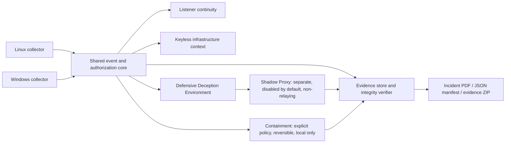

# CloudSentry LDAE: Audit and Incremental Plan

## Repository audit (baseline: `main` at `a412d10`)

- Core: Python package `src/reverse_shell_decoy`, 393 unit tests, standard-library-first.
- Portal: TypeScript/Node service under `portal/`; Vitest dependencies are not installed in the audit environment.
- Existing relevant modules: `listeners.py` (bounded, read-only Linux `/proc` inventory), `detector.py`, `correlation.py`, `authorization.py`, `evidence.py` (hash-checked ZIP evidence bundles), `collectors.py` (bounded read-only cloud-log ingestion), and `honeypot.py`/`simulator.py` (synthetic shell decoy, not a real shell).
- Existing controls to preserve: authorization gates, bounded input/output/resource limits, loopback-first decoys, explicit simulation boundaries, privacy-aware evidence export, and no outbound probing/retaliation.
- The current codebase is not a Windows host monitor. The existing listener inventory is a Linux `/proc` snapshot and does not establish an exhaustive or tamper-resistant process identity. The core does not yet provide persistent listener history, OS-level containment, RDAP/ASN intelligence, or the requested three-file incident package.
- No existing active-probe implementation is part of this increment. The `feature/active-probe` branch is separate and must remain experimental/unreviewed.

## Baseline verification

- `PYTHONPATH=src python3 -m unittest discover -s tests -p 'test_*.py'`: **393 passed** before this increment.
- Portal tests: **not run**; `pnpm test` fails because `portal/node_modules` (including Vitest) is absent.
- Tests require `PYTHONPATH=src` in this environment. Running unittest without it yields import errors.

## Implementation approach

1. **Shared schema (this increment):** canonical event timestamps, identifiers, host/platform/source/confidence fields, tri-state authorization, JSON serialization, and tests that UNKNOWN stays UNKNOWN absent explicit policy.
2. **Listener identity continuity:** build on the existing bounded Linux scanner; add historical identity records and negative/race tests. Avoid treating a changed process identity as proof of maliciousness.
3. **Cross-platform collectors:** isolate platform-specific code behind a common interface. Windows implementation must be tested on Windows before claiming support; Linux collection should reuse existing `listeners.py` parsing rather than duplicate it.
4. **Keyless network context:** local cache, source timestamps, and provenance for RDAP/provider-range data; distinguish observations from infrastructure-level inference.
5. **Shadow Proxy / Defensive Deception Environment:** a standalone, separately gated module, loopback-bound by default. Its proxy-like HTTP/SOCKS recognition must parse only bounded request metadata, reject CONNECT/forwarding without relay, never store credentials, and produce synthetic, separately tagged events. External exposure requires explicit operator authorization and firewall review. Protocol emulation remains disabled by default; rotation of synthetic identities needs a private, integrity-protected audit trail. It must not share listeners, credentials, or production service paths.
6. **Containment:** observe/alert first; any local firewall/process action requires explicit policy and operator authorization, with evidence preserved before action and tested rollback. No default enforcement.
7. **Evidence export:** independently hashed source artifacts, verification command, and PDF/JSON/ZIP package; clearly separate direct observations from interpretations and synthetic DDE/Shadow Proxy events.
8. **Platform/integration testing:** add actual Linux and Windows CI runners where available, plus negative, integration, failure-mode, and mutation tests. Mock-only Windows tests do not establish Windows support.

## Current status

Only the shared event-schema increment is in scope for the first change. The remaining items are not implemented or production-ready. Shadow Proxy is planned as a distinct, non-relaying defensive decoy, not an open proxy. No listener or protocol emulation is enabled in this increment.

## Target architecture (phased, not yet fully implemented)

## Security review for the first increment

- The event host identifier defaults to `unknown-host` rather than disclosing the machine hostname; deployments may supply an operator-managed pseudonymous identifier.
- Authorization is tri-state. Missing process identity data stays `UNKNOWN`; an explicit matching port/protocol rule is required before a mismatch can become `UNAUTHORIZED`. A sensitive port alone is only a policy hint.
- Event details remain caller-provided; collectors must sanitize/redact before constructing events. The core does not claim cryptographic signing or tamper-proof storage.
- No network listeners, process termination, firewall modifications, remote lookups, or platform collection are performed by this increment.

## Increment 1 verification

- Focused shared-core suite: **10 tests passed** (`tests/test_core_engine.py`).
- Full Python suite after increment: **403 tests passed**.
- Portal tests remain unrun because Vitest dependencies were absent. No Windows test host was available; this increment contains no Windows collector.
- Shadow Proxy protocol parsing, socket isolation, budgets, identity rotation, and integration/evidence tests remain future work; no proxy listener is included or enabled here.

## Permanent development rules

These are standing rules for every CloudSentry development increment:

1. **Independent verification:** Every security claim needs a test.
2. **Fail visibly:** Missing telemetry must never look like a clean system.
3. **Least privilege:** Components get only the access they need.
4. **Evidence integrity:** Preserve original observations separately from conclusions.
5. **Continuous adversarial review:** Every new feature gets a failure-mode review before integration.

## Increment 2: shared-core hardening

Target branch: `feature/ldae-shared-core`; do not alter `main`. Authorization now requires explicit exposure or bind-address scope and can additionally constrain interface and network namespace. Evidence append coordination uses cross-process OS file locking, with state refreshed while locked. Path-only authorization is labeled and explicitly approved; PID identity has assurance levels; optional HMAC checkpoints can anchor historical journal prefixes. Listener, policy, and provenance inputs are validated. See [`ldae-shared-core-security-findings.md`](ldae-shared-core-security-findings.md) for tests and limitations.

Verification in this worktree: focused shared-core suite **45 passed**, full Python suite **438 passed**. Windows lock execution and authenticated running-image collection are not verified. This increment does not include the Linux collector or Shadow Proxy.

### Listener continuity and recovery acceptance criteria (future increment)

Recovery is a continuity-detection workflow, not an automatic remediation loop. A future collector must:

- Detect when a previously observed listener disappears and later reappears, recording the recurrence as a distinct canonical event linked to the original observation. Preserve the original action, result, and evidence; never overwrite the first observation with the recurrence.
- Compare process identity using available PID, creation time, OS file identity, executable path, and hash provenance. Report the assurance level and explicitly mark changed, incomplete, or unavailable identity as uncertain; PID equality alone is not continuity.
- Preserve the complete available listener payload and its collection provenance. If payloads exceed event limits, store the original as a separately bounded evidence artifact with a digest/reference and an explicit completeness/truncation status; do not silently omit fields or call partial telemetry complete. Keep raw observations distinct from derived conclusions.
- Never automatically terminate a replacement process because an earlier process was stopped or authorized. Any response against the replacement requires fresh, scope-specific authorization and a recorded decision.
- Emit auditable events for the action, its result, evidence references, recurrence link, and authorization basis. Tests must cover reappearance, PID reuse, missing identity fields, replacement executable/hash, incomplete payloads, separate-event preservation, and refusal to auto-kill without reauthorization.

These are planned requirements, not functionality delivered by Increment 2. Increment 2 only provides shared identity assurance and evidence primitives; it does not run a persistent listener watcher or take process actions.

### Shadow Proxy session-control-plane direction (future design)

The Shadow Proxy, if implemented later, must control only CloudSentry-owned proxy sessions and resources, never the remote client. Unknown identity is not evidence of abuse, and IP reputation or IP allow/deny lists must not substitute for session authentication, behavior, service policy, or budgets. Session policy should distinguish configured/authorized service behavior, unknown sessions with a restricted initial capability set, behavior-based progressive constraints, policy-violation suspension/termination, and confirmed abuse with optional scoped temporary blocking. Any "allow" means an explicitly configured service capability; it does not permit arbitrary forwarding or bypass the existing non-relay requirement.

Local administrative operations may include `INSPECT`, `SLEEP`, `RESUME`, `TERMINATE`, `BLOCK`, and `RELEASE`. They must be authenticated, locally scoped, auditable with actor, target session, decision, result, policy revision, and evidence references. `SLEEP` limits only CloudSentry's own synthetic responses and resource allocation; `RESUME` restores only capabilities still permitted by current policy; `BLOCK` and `RELEASE` affect only configured local admission policy and must not automatically penalize shared VPN/cloud address ranges. Unknown sessions should start with finite, non-disruptive capabilities; progressive restrictions must be based on observable behavior and explicit policy, with no deliberately expensive work. This is a design direction, not implemented functionality.
